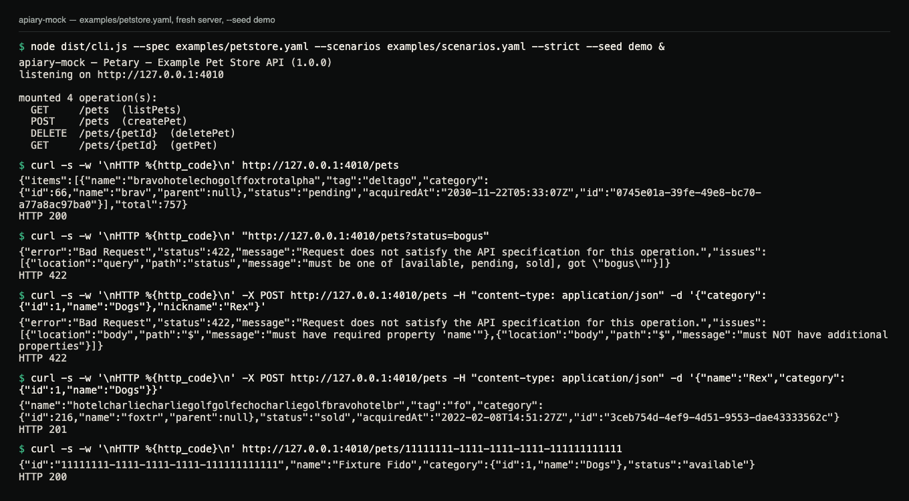
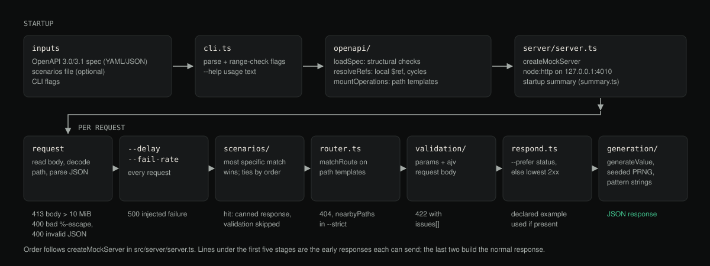

# apiary-mock

A mock HTTP server generated from an OpenAPI 3.0/3.1 document. It validates
each request against the spec before answering and rejects the ones the spec
does not allow.

## Demo



Terminal capture of a real session: the server started with the bundled pet store spec and
scenarios, then five requests from a second shell. Generated values come from the seed, so they
differ with another `--seed`. A fresh server started with the same seed and sent the same
requests in the same order returns these exact responses, because the generator is seeded from
the seed, the operation and a per-server count of generated responses (requests answered with a
422 or a scenario fixture do not advance it). The same session as text:

<details>
<summary>Full output</summary>

```console
$ node dist/cli.js --spec examples/petstore.yaml --scenarios examples/scenarios.yaml --strict --seed demo &
apiary-mock — Petary — Example Pet Store API (1.0.0)
listening on http://127.0.0.1:4010

mounted 4 operation(s):
  GET     /pets  (listPets)
  POST    /pets  (createPet)
  DELETE  /pets/{petId}  (deletePet)
  GET     /pets/{petId}  (getPet)

$ curl -s -w '\nHTTP %{http_code}\n' http://127.0.0.1:4010/pets
{"items":[{"name":"bravohotelechogolffoxtrotalpha","tag":"deltago","category":{"id":66,"name":"brav","parent":null},"status":"pending","acquiredAt":"2030-11-22T05:33:07Z","id":"0745e01a-39fe-49e8-bc70-a77a8ac97ba0"}],"total":757}
HTTP 200

$ curl -s -w '\nHTTP %{http_code}\n' "http://127.0.0.1:4010/pets?status=bogus"
{"error":"Bad Request","status":422,"message":"Request does not satisfy the API specification for this operation.","issues":[{"location":"query","path":"status","message":"must be one of [available, pending, sold], got \"bogus\""}]}
HTTP 422

$ curl -s -w '\nHTTP %{http_code}\n' -X POST http://127.0.0.1:4010/pets -H "content-type: application/json" -d '{"category":{"id":1,"name":"Dogs"},"nickname":"Rex"}'
{"error":"Bad Request","status":422,"message":"Request does not satisfy the API specification for this operation.","issues":[{"location":"body","path":"$","message":"must have required property 'name'"},{"location":"body","path":"$","message":"must NOT have additional properties"}]}
HTTP 422

$ curl -s -w '\nHTTP %{http_code}\n' -X POST http://127.0.0.1:4010/pets -H "content-type: application/json" -d '{"name":"Rex","category":{"id":1,"name":"Dogs"}}'
{"name":"hotelcharliecharliegolfgolfechocharliegolfbravohotelbr","tag":"fo","category":{"id":216,"name":"foxtr","parent":null},"status":"sold","acquiredAt":"2022-02-08T14:51:27Z","id":"3ceb754d-4ef9-4d51-9553-dae43333562c"}
HTTP 201

$ curl -s -w '\nHTTP %{http_code}\n' http://127.0.0.1:4010/pets/11111111-1111-1111-1111-111111111111
{"id":"11111111-1111-1111-1111-111111111111","name":"Fixture Fido","category":{"id":1,"name":"Dogs"},"status":"available"}
HTTP 200
```

</details>

## What it does

`apiary-mock` reads an OpenAPI document, mounts every declared operation and
serves it over plain HTTP. Before it answers, it checks the path, query and
header parameters and the request body against the spec, and returns a 422
listing every problem it found (a body that is not valid JSON gets a 400).
Valid requests get a response built from the operation's response schema: the
declared `example` if there is one, otherwise a generated value that satisfies
the schema's constraints. With a
fixed `--seed`, the same sequence of requests produces the same responses.

## Why

A mock server that accepts any request lets a client get away with a wrong
content type, a missing required field or an out-of-range enum, and the
mistake only shows up against the real backend. This one fails those requests
the way the spec says the real API should.

## Features

- **OpenAPI 3.0/3.1 loading** from YAML or JSON, with local `$ref` resolution,
  including refs nested several levels deep and circular schemas (e.g. a
  `Category` that references its own `parent`).
- **Request validation**: path, query, and header parameters (type, format,
  required, enum, numeric bounds, string length, pattern) and the request
  body against its JSON Schema (via [ajv](https://ajv.js.org)), including
  content-type negotiation. Violations come back as a 422 (a body that
  is not valid JSON gets a 400) with a body of the form
  `{"error", "status", "message", "issues": [{"location", "path", "message"}]}`.
- **Schema-driven response generation**: uses a declared `example`/`examples`
  when present; otherwise synthesizes a value honoring `type`, `format`
  (`date-time`, `date`, `uuid`, `email`, `uri`, `hostname`, `ipv4`), `enum`,
  `minimum`/`maximum`, `minLength`/`maxLength`, `pattern` (best-effort regex
  generation), `required`, and nested objects/arrays. Output is deterministic
  for a given `--seed` and request order.
- **Scenario replay**: point `--scenarios` at a file mapping request matchers
  (method/path/query/body predicate) to canned responses, so you can force a
  409, a specific error payload, or an empty page on demand. A scenario can
  also set its own `delayMs`.
- **Status code selection**: `--prefer 201` picks a specific declared
  response; otherwise the lowest 2xx wins.
- **`--strict` mode**: 404s for unmatched routes come with a list of the
  nearest known paths, undeclared query parameters are rejected, request-body
  properties not in the schema are rejected (when the schema does not set
  `additionalProperties` itself), and a body sent to an operation that doesn't
  accept one is rejected too.
- **Resilience testing**: `--delay` adds artificial latency to every
  response; `--fail-rate` randomly injects 500s. Both apply before scenario
  matching, so scenario responses are delayed and failed too.
- **Startup summary**: prints every mounted method + path (+ operationId) so
  you can see at a glance what's being served.

## Architecture



Diagram (not a screenshot): the startup path and the per-request stages, with the early responses each stage can send.

```
src/
  openapi/     document loading (YAML/JSON), $ref resolution, path-template
               compilation, and flattening the doc into MountedOperations
  validation/  parameter validation + ajv-backed request body validation,
               plus an OpenAPI -> plain-JSON-Schema converter (nullable, and
               circular-schema cycle-breaking so ajv can compile it)
  generation/  seeded PRNG, a best-effort regex -> string generator for
               `pattern`, and the schema -> value generator itself
  scenarios/   scenario file loading and request matching
  server/      routing, response selection, the node:http server, and the
               startup summary printer
  cli.ts       argument parsing and the executable entry point
  index.ts     library entry point re-exporting the pieces above
```

Each request goes through these steps in order (see `createMockServer` in
`src/server/server.ts`):

1. Read the body (413 above 10 MiB), decode the path (400 on malformed
   percent-encoding) and parse a JSON body (400 if it is not valid JSON).
2. Wait `--delay` ms, then fail with a 500 at `--fail-rate`.
3. Check scenarios; the most specific match wins, ties go to the earlier
   entry. A match is returned as-is (after its own `delayMs`), without
   validation.
4. Route to an operation: 404 if none matches, with nearby-path hints in
   `--strict`.
5. Validate the request against that operation: 422 on violation.
6. Pick the response (`--prefer`, else the lowest declared 2xx) and generate
   its body.

## Installation

apiary-mock is not published to the npm registry. Install it from a clone.
Requires Node.js 20+ (CI tests 20, 22 and 24 on Linux, macOS and Windows).

```bash
git clone https://github.com/hellpuffyt/apiary-mock.git
cd apiary-mock
npm install
npm run build
```

## Usage

From the clone (after `npm run build`):

```bash
npx apiary-mock --spec ./examples/petstore.yaml
# or: node dist/cli.js --spec ./examples/petstore.yaml
```

`node dist/cli.js --help` prints:

```
apiary-mock — a strict OpenAPI mock server

Usage:
  apiary-mock --spec <path> [options]

Options:
  --spec <path>        Path to an OpenAPI 3.0/3.1 document (YAML or JSON). Required.
  --scenarios <path>   Path to a scenarios file (YAML or JSON) for canned responses.
  --port <n>           Port to listen on (default: 4010).
  --host <host>        Host to bind to (default: 127.0.0.1).
  --strict             404 unmatched requests with nearby-path suggestions and reject
                        undeclared query params / extra body properties.
  --prefer <status>    Prefer this response status code when an operation has several.
  --delay <ms>         Add artificial latency (in ms) to every response.
  --fail-rate <0..1>   Fraction of requests to fail with a 500, for resilience testing.
  --seed <string>      Seed for deterministic response generation (default: "apiary-mock").
  -h, --help           Show this help text.
```

On startup it prints what it mounted:

```
apiary-mock — Petary — Example Pet Store API (1.0.0)
listening on http://127.0.0.1:4010

mounted 4 operation(s):
  GET     /pets  (listPets)
  POST    /pets  (createPet)
  DELETE  /pets/{petId}  (deletePet)
  GET     /pets/{petId}  (getPet)
```

### As a library

In another project, install from the clone path (`npm install ../apiary-mock`)
and start a server in-process, for example in a test:

```js
import { loadSpec, createMockServer } from "apiary-mock";

const server = createMockServer({
  doc: loadSpec("examples/petstore.yaml"),
  strict: true,
  seed: "my-test",
});
const { port } = await server.listen(0); // 0 = any free port, on 127.0.0.1

const res = await fetch(`http://127.0.0.1:${port}/pets?status=bogus`);
console.log(res.status, (await res.json()).issues[0].message);
// 422 must be one of [available, pending, sold], got "bogus"

await server.close();
```

`createMockServer` also accepts `scenarios` (from `loadScenarios(path)`),
`preferStatus`, `delayMs`, `failRate` and `maxBodyBytes`. The package ships
TypeScript declarations.

## Scenarios format

A scenarios file is a YAML or JSON document with a top-level `scenarios`
array. Each entry has a `match` and a `response`:

```yaml
scenarios:
  - name: force a conflict when creating a pet named "Duplicate"
    match:
      method: POST
      path: /pets
      body:
        name: Duplicate          # partial/deep match: only these keys are checked
    response:
      status: 409
      headers:
        content-type: application/json
      body:
        message: A pet named "Duplicate" already exists
        code: CONFLICT

  - name: filtering by sold status returns an empty page
    match:
      method: GET
      path: /pets
      query:
        status: sold
    response:
      status: 200
      body:
        items: []
        total: 0
```

A `response` has `status`, optional `headers`, optional `body`, and an
optional `delayMs` applied to that scenario only.

`match` supports `method`, `path` (exact) or `pathPattern` (regex), `query`
(exact key/value match), and `body` (a deep partial match: every key in the
matcher must be present and equal in the actual body; extra keys in the
actual body are ignored). When more than one scenario matches, the more
specific matcher wins (more declared fields = more specific); ties are
broken by declaration order. A matched scenario is served as-is and skips
request validation, so it can return responses the spec would not otherwise
produce.

## Examples

The `examples/` directory has a runnable pet store spec and scenario file:

```bash
node dist/cli.js --spec examples/petstore.yaml --scenarios examples/scenarios.yaml --strict

curl http://127.0.0.1:4010/pets
curl "http://127.0.0.1:4010/pets?status=bogus"        # 422, not a valid enum value
curl -X POST http://127.0.0.1:4010/pets \
  -H "content-type: application/json" \
  -d '{"name":"Rex","category":{"id":1,"name":"Dogs"}}' # 201, schema-generated body
curl http://127.0.0.1:4010/pets/11111111-1111-1111-1111-111111111111  # scenario fixture
```

The 422 body for the second request:

```json
{"error":"Bad Request","status":422,"message":"Request does not satisfy the API specification for this operation.","issues":[{"location":"query","path":"status","message":"must be one of [available, pending, sold], got \"bogus\""}]}
```

## Testing

```bash
npm test          # vitest
npx tsc --noEmit  # typecheck (src + test)
npx eslint .      # lint (0 errors; the test files currently have 17 no-explicit-any warnings)
npm run build     # compile to dist/
```

The suite (184 tests across 13 files) covers `$ref` resolution (including
nested and circular schemas), request validation for every violation class
*and* valid-request false-positive guards, schema-driven generation and its
constraints, determinism under a fixed seed, scenario matching precedence,
strict mode, and the server exercised over real HTTP on an ephemeral port.
`test/audit-regressions.test.ts` additionally checks generated values against
an independent ajv instance (every petstore response body across 100 seeds,
plus edge-case numeric/string/array/object constraints) and covers malformed
and hostile specs and request paths.

## Limitations

- Only local `$ref`s (`#/...`) are supported; no external file or URL refs.
- `pattern` generation is best-effort: it covers literals, character
  classes, `\d \w \s` shorthands (and negations), groups, alternation, and
  the common quantifiers. Lookaround and backreferences aren't supported and
  fall back to a generic string.
- Recursive schemas (e.g. `Category.parent -> Category`) are generated and
  validated to one level of depth; beyond that, generation stops descending
  (emitting `null`, which violates the schema if that recursive property is
  *required* and not nullable) and validation permits anything, to avoid
  infinite structures.
- Generated strings honour either `format` or `pattern`; `minLength`/
  `maxLength` are not re-applied on top of a `format`/`pattern` value, and
  `multipleOf` on a non-integer step for an `integer` falls back to a bound.
- Spec validation at load time is structural (version, `paths`, operations
  with non-empty `responses`, parameter `name`/`in`); it is not a full
  OpenAPI schema validation of the document.
- OpenAPI parameter `style`/`explode` handling is simplified: array-valued
  query parameters are read either as repeated `?a=1&a=2` or a single
  comma-separated value.
- `oneOf`/`anyOf` request bodies are validated with ajv's standard
  (non-discriminated) semantics; no `discriminator` shortcut is implemented.

## Security

apiary-mock is a development tool. It executes no code from the OpenAPI
document or scenario files beyond parsing YAML/JSON, evaluating declared
`pattern`/`pathPattern` values as regular expressions (from files you point
it at), and returning declared/generated data. Do not point it at untrusted
specs or scenario files, and do not expose it on a public network. It is
meant to run on `127.0.0.1` during local development or CI.

Hardening that is in place: the server binds `127.0.0.1` by default; request
bodies over 10 MiB are refused with `413` (library option `maxBodyBytes`);
malformed percent-encoding in a path is a `400`; YAML is parsed with js-yaml's
default (safe) schema, so `!!js/*` tags are rejected; YAML aliases are not
expanded into copies (a small "billion laughs" document loads instantly);
`$ref` pointers only follow the document's own properties; and numeric CLI
flags are range-checked. A `pattern` from the spec is still run against
request input, so a catastrophic-backtracking pattern in a spec can be slow.

Please report vulnerabilities privately as described in [SECURITY.md](./SECURITY.md).

## Contributing

See [CONTRIBUTING.md](./CONTRIBUTING.md). Changes are recorded in
[CHANGELOG.md](./CHANGELOG.md).

## License

MIT © 2026 Prabesh Sharma. See [LICENSE](./LICENSE).
